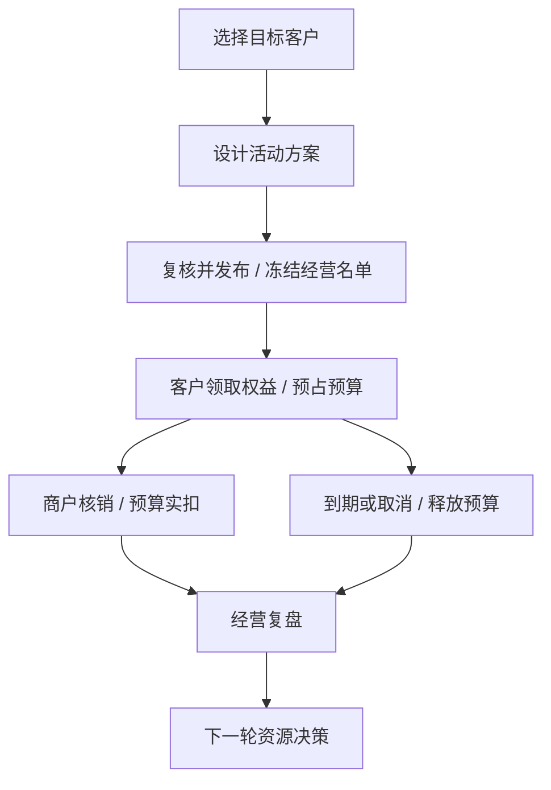

# 渝惠｜银行零售客户经营与场景权益平台

一次零售客户经营活动，从“选哪些客户、给什么权益、花多少预算”，到客户领取、商户核销，再到活动结束后的成本和效果复盘，都可以在同一套系统中完成。

> **Personal Project · Synthetic Demo**  
> 所有客户、商户、交易和经营结果均为合成演示数据，不代表任何真实机构的经营数据。

[在线交互演示](https://sgyuhan23.github.io/yuhui-retail-banking-platform/) · [了解案例](#不用安装直接走完这次活动) · [合成经营案例](#一个完整的合成经营案例) · [本地运行](#本地运行)

## 30 秒看懂渝惠

### 1. 选谁

从客户中筛选适合本次活动的人群，并在发布时冻结本次实际经营名单。

### 2. 给什么

为目标客群配置具体生活场景、合作商户和权益。

### 3. 花多少

活动有明确预算；客户领取时先占用预算，实际核销后才形成实际成本。

### 4. 怎么执行

客户领取权益后，在符合条件的商户完成核销；过期未使用的权益会释放占用预算。

### 5. 做完怎么办

活动结束后查看客户参与、核销、成本和商户差异，并记录下一轮是扩大、保持、缩减还是停止。

## 业务闭环

选择目标客户 → 设计活动方案 → 复核并发布、冻结经营名单 → 客户领取权益 → 商户核销 → 预算实扣或释放 → 经营复盘 → 下一轮资源决策。



手工客群快照用于观察和留存；实际投放使用发布时冻结的名单。停止投放后，已领取的权益仍继续跟踪至履约结束。

## 不用安装，直接走完这次活动

[进入展示页面](https://sgyuhan23.github.io/yuhui-retail-banking-platform/)。可直接查看任意步骤，页面载入该阶段的预设状态；选择“体验完整流程”则按审核、领券、核销和结算的顺序推进，不需要安装运行环境。

**案例背景：** 拿出 6000 元银行预算，邀请较长时间未活跃的涪陵客户使用社区生活优惠。客户可领“满 40 减 20”券，银行承担 12 元，商户承担 8 元，领取后 7 天有效。

| 这一步 | 经营人员需要弄清的问题 | 本案例怎样处理 |
|---|---|---|
| 选客户 | 有限预算发给谁？ | 30000 名合成客户中，同时满足涪陵、60–180 天未活跃、积分 ≥2000、社区偏好与营销许可的有 2166 人；积分条件是预设客群假设，领券不扣积分。 |
| 定方案 | 给什么，谁承担费用？ | 8 家虚构社区商户，满 40 减 20；6000 元预算按每份 12 元预留，可同时承担 500 份。 |
| 审方案 | 实际执行是否仍是审核过的内容？ | 审核后修改关键配置会拦截发布；重新复核后才能继续，发布时保存名单。 |
| 领优惠 | 领券后钱是否已花掉？ | 先预留 12 元，避免超发；此时尚未计入实际成本。 |
| 用优惠 | 什么时候计入成本？ | 商户确认券已使用，12 元从预占转为银行成本，重复确认不重复扣减。 |
| 收尾 | 停止发券以后怎么办？ | 继续处理已发券：275 人使用、225 份到期未用；形成 3300 元成本、释放 2700 元。 |
| 做判断 | 下一轮如何调整？ | 比较商户使用率和成本；对低于 20% 提示线的商户进一步调查，记录规模决定、理由和指标快照。 |

展示页面使用完整系统固定案例的数据，交互在浏览器本地运行，不调用后端。单人领取和使用用于讲解预算变化，随后明确切换至完整案例结果；用户操作不会重新生成或改写案例统计。

## 一个完整的合成经营案例

以下数字来自固定种子 `202610` 生成的 Synthetic Demo，用于演示系统如何执行和复盘，不代表真实经营效果。

**沉默客户社区生活权益经营案例**

| 客户阶段 | 人数 |
|---|---:|
| 目标客群 | 2166 |
| 触达 | 1563 |
| 参与 | 964 |
| 领取 | 500 |
| 核销 | 275 |
| 目标行为 | 224 |

| 预算与目标 | 数值 |
|---|---:|
| 总预算 | ¥6000 |
| 实际成本 | ¥3300 |
| 释放预算 | ¥2700 |
| 商户承担 | ¥2200 |
| 预设目标 | 150 |
| 观察结果 | 224 |
| 目标完成率 | 149.3% |

> 149.3% 表示该合成案例中“观察结果 ÷ 预设目标”，不是客户活跃提升 149.3%，也不代表营销因果效果。

目标行为统计投放批次观察窗口内的去重客户；核销、实际成本和释放预算统计截至复盘时刻的累计履约。释放预算是累计流水，不与当前预占重复加总。

## 核心设计与实现

- **客群筛选与冻结**：Snapshot 即冻结某一时点的经营客群，保留投放名单与规则依据。
- **场景、商户与权益**：明确适用范围、门槛、有效期，以及银行成本和商户承担部分。
- **活动复核与版本冻结**：已审核的配置与实际执行保持一致，发布版本被投放批次引用。
- **活动总预算上限**：Campaign-level Budget Cap 覆盖活动下所有投放批次，防止多批次累计超支。
- **预算流水（Budget Ledger）**：记录预算为什么被占用、实际使用或释放；Reserve 是已承诺但尚未成为实际成本的预算，Commit 是实际核销成本，Release 是到期或取消后释放的预算。
- **事件流水（Event Ledger）**：记录客户在活动里发生了什么，支持去重统计和追溯。
- **权益领取与商户核销**：校验条件，并防止重复领取或重复扣减。
- **目标与履约分开观察**：目标完成情况按观察窗口统计，已领取权益继续跟踪至核销或到期。
- **经营复盘与决策记录（Decision Record）**：保留扩大、保持、缩减或停止的原因及当时指标。
- **固定种子合成演示与自动验收**：相同种子可复现客户、事件和经营汇总。

## 技术实现

### 当前经营主链

Java 17、Spring Boot 2.7.12、MySQL；React 18、Umi、Ant Design 5。

数据库事务保证关联写入一起成功或回滚；行锁控制并发预算扣减；唯一约束防止重复业务记录；数据库触发器保护不可变记录。

代码中的 Segment 对应客群规则，Snapshot 对应冻结名单，Campaign 对应经营方案，Version 对应发布版本，Run 对应投放批次，Ledger 对应可追溯流水。

### 保留的营销能力

Redis / Redisson、RabbitMQ、Alias Method、DB-Router、ZooKeeper DCC，用于既有积分、抽奖、行为奖励、额度和履约链路。

Dubbo/Nacos 调用链、Canal/Elasticsearch 同步、XXL-JOB 调度中心不主张为当前活跃运行链路；未使用 ShardingSphere-JDBC。

## 源码结构

| 目录 | 内容 |
|---|---|
| [yuhui-server](yuhui-server) | 后端源码；[经营主链](yuhui-server/entrypoints/src/main/java/com/yuhui/operating) |
| [yuhui-web](yuhui-web) | 前端源码；[经营页面](yuhui-web/src/pages/Operating) |
| [infra](infra) | 数据库与环境初始化 |
| [scripts](scripts) | 本地启动和验收脚本 |
| [verification](verification/README.md) | 工程验收记录 |
| [docs](docs/README.md) | 产品规则、数据模型与运行说明 |

## 验证

当前公开版本保留完整工程验收记录，包括后端构建及单测、活动预算与复核一致性定向验收、经营主链验收、原营销链路回归、前端构建及类型检查、固定种子 Demo 可复现性。

本地记录：单测 22/22、定向验收 22/22、主链验收 48/48、营销链路 10/10 组。详见 [验证索引](verification/README.md)。这些是项目工程验收记录，不是第三方认证、真实银行生产验收或安全认证。

[Repository quality](https://github.com/SGYuhan23/yuhui-retail-banking-platform/actions/workflows/quality.yml) 检查后端单测、前端类型与构建、公开文件规范；CI 不运行依赖完整数据库与中间件的集成验收。

## 本地运行

### Prerequisites

- Java 17（POM）；Maven 3.x（本地 Maven 3.9.14）。
- Node.js 20（本地 20.20.2）、pnpm（现有本地 11.25.0）；CI 使用 Node 22 / pnpm 10，已在 GitHub Actions 验证依赖安装、类型检查与前端构建通过。
- Docker Desktop / Docker Engine 与 Compose v2；Python 3；Bash。
- Compose 镜像：MySQL 8.0、Redis 7、RabbitMQ 3.13-management、ZooKeeper 3.8。完整本地主线需要这些服务。

Helper 主要在 macOS 验证。Linux 可显式设置 JAVA_HOME；Windows 原生命令未验证，建议使用有 Docker 的 WSL2 环境自行核验。

### Quick Start

```bash
# 在仓库根目录，先设置本机 JDK 17 的 JAVA_HOME
export PATH="$JAVA_HOME/bin:$PATH"
bash scripts/start.sh
DEMO_SEED=202610 python3 scripts/reset-demo-data.py
```

启动脚本会拉起4个依赖、应用SQL（含07迁移）、构建后端/前端、启动本地服务并预热。首次需网络下载依赖。端口占用时先停止其他项目实例。目录不附带 node_modules、target、dist。

- 工作台：http://127.0.0.1:18000/operating/overview
- 消费者：http://127.0.0.1:18000/experience
- 钱包：http://127.0.0.1:18000/wallet
- 后端：http://127.0.0.1:18091/api/v1

停止：`bash scripts/stop.sh`。已有构建可使用 `bash scripts/start.sh --no-build`。手工启动及环境解释见 [本地运行详解](docs/local-run.md)。

### Demo Reset

```bash
DEMO_SEED=202610 python3 scripts/reset-demo-data.py
```

仅用于本项目本地合成 Demo。显式删除并重建所有 `v3_` 演示事实，不删除旧积分/抽奖台账。自增ID和管理时间可以变化，固定客户内容和经营汇总可复现。不要在真实生产环境执行。Reset 不是公开线上功能。

## 事实边界

个人产品实践，非任何银行官方或内部系统。客户、商户、交易与经营结果均为合成数据；不包含真实银行账户、支付或清结算。本地固定体验身份不等于生产认证。

[完整事实边界](docs/truth-boundaries.md) · [NOTICE](NOTICE.md)
